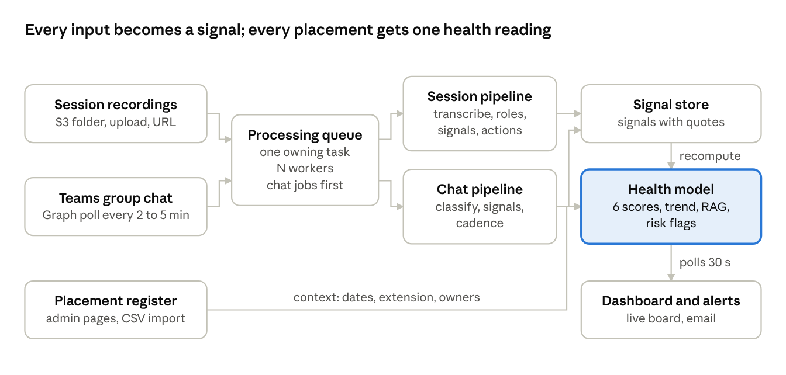

# Architecture Overview

> **Status**: Sprint 2 in progress (Health v1); Phase 1 done 2026-10-09: the backend target group drains for 60 s, so a deploy hands processing over in about 2½ minutes. Phase 2: migration 006 (health snapshots, risk flags, `signals.indicator`, the embedding index) and the pure health model (see "Health model (as built)"); nothing calls it yet. Phase 3: the session pipeline tags the critical indicators, and a completed session's signals are embedded (see "Session pipeline (as built)"), with `make backfill-embeddings` for any a failed step left empty. Phase 4: the health recompute stores a snapshot and opens flags after every analysed call, register edit and import, daily when enabled, and at takeover for any placement out of date (see "Health recompute (as built)"); the processing queue runs a job asked for during its run once more. Phase 5: the risk board and placement health routes, with the SME technical view (see "Health views (as built)"), and migration 007 (the Technical trend on each snapshot); a takeover step logs its count even at zero. Sprint 1 complete (2026-10-09). **Built**: the backend skeleton (see "Backend (as built)"), with migrations 001–005 (003: the session and recordings tables; 004: recording scans; 005: signals, issues and actions), the ingestion building blocks (media storage, recording checks, upload, URL download with an SSRF guard, AssemblyAI client), the recordings folder scanner (on in staging since 2026-10-09, reading the main account's bucket through its bucket policy), the session service with its `session` job (copy or download, transcribe, analyse), the session pipeline with verified signals (see "Session pipeline (as built)"; not yet run on a real call), the recordings and session routes, the Admin > Recordings tab with the upload and URL dialogs, the sessions list and the session page with its recording player and session scope (see "Frontend (as built)"), sign-in for tenant members with a role, and the placement register with CSV import (also in "Backend (as built)"), the frontend skeleton with the Admin register and import (see "Frontend (as built)"), local development with CI/CD (see "Local development and CI/CD (as built)"), and the staging infrastructure with PMO's Azure OpenAI and the Entra SSO app (see "Infrastructure (as built)"). Everything else is the planned design from `docs/PRD.md`; update each section as it is built.

## System Design
PMO Intelligence has 3 inputs, 1 queue, 2 pipelines and 1 health model. Every input becomes a signal, and every placement gets one health reading.

- **Session recordings** (S3 folder, upload, URL) and **Teams group chat** (Graph poll every 2 to 5 min) → **Processing queue** (one owning task, N workers, chat jobs first)
- Processing queue → **Session pipeline** (transcribe, roles, signals, actions) and **Chat pipeline** (classify, signals, cadence)
- Both pipelines → **Signal store** (signals with quotes) → recompute → **Health model** (6 scores, trend, RAG, risk flags)
- **Placement register** (admin pages, CSV import) → Health model (context: dates, extension, owners)
- Health model → polls 30 s → **Dashboard and alerts** (live board, email)

Recordings and chat both pass through the one processing queue into their pipelines. Everything they extract lands in the signal store. The health model recomputes the placement after every job and reads the register for context. The dashboard and alerts read the latest snapshot.

It uses the same stack as Interview Intelligence in a new repository, with three new pieces: a Microsoft Graph connector for Teams, the signal store with the health model, and a dashboard built around people rather than recordings.

**What is deliberately not shared**: no shared database, no shared service code at runtime, no monorepo. Files worth copying (the processing queue, the ownership lock, the LLM factory, the entitlement helper shape, the test conftests) are copied in and allowed to diverge.

## Backend (as built)
FastAPI app in `backend/app/`, layered routes → services → repositories → models.

| Area | Path | Notes |
|------|------|-------|
| App and lifespan | `app/main.py` | Startup: bootstrap-admin grant, the runners and takeover steps registered (recordings scan, sessions, health), then the processing takeover in a background task; the 15-minute scan loop and the daily health loop when enabled. Shutdown: the loops, then queue stop, then lock release. |
| Settings | `app/config.py` | `pydantic-settings`, env vars or `.env`; `RECORDINGS_BYTES_PER_SECOND` (79,000) for the cost estimate before Process; transcription on AssemblyAI's EU endpoint (`ASSEMBLYAI_BASE_URL`) with `ASSEMBLYAI_SPEECH_MODELS` `["universal-3-5-pro", "universal-2"]`; `APP_DEBUG` (SQL echo) is off unless set, and compose and `.env.example` turn it on for development; the session pipeline's `SESSION_NODE_TIMEOUT_SECONDS` (240), `SESSION_REASONING_EFFORT` (`medium`) and `SESSION_RESOLVED_ISSUE_LOOKBACK_DAYS` (30); signal embeddings' `SIGNAL_EMBEDDING_BATCH_SIZE` (100) and `SIGNAL_EMBEDDING_TIMEOUT_SECONDS` (120); the health model's `HEALTH_CONFIG_VERSION` (`v1`), `HEALTH_DAILY_ENABLED` (off), `HEALTH_DAILY_HOUR` (6) and `HEALTH_TIMEZONE` (Europe/London) |
| Routes | `app/api/v1/{health,auth,processing,register,users,recordings,sessions,placement_health}.py` | See `docs/API.md`; `health.py` is the `/health` probe, `placement_health.py` the risk board and placement health |
| Upload body limit | `app/middleware/body_limit.py` | `POST /api/v1/sessions/upload` only: answers 413 once the body passes `MAX_UPLOAD_SIZE_MB` + 1 MiB, at once from `Content-Length` or as chunks arrive, so an oversized upload is never spooled to disk in full (Starlette parses a multipart body before the route runs) |
| Placement register | `app/services/register_service.py`, `app/services/register_import.py`, `app/db/repositories/{consultant,client,project,placement}_repo.py` | Create and edit consultants, clients, projects and placements; CSV import. Rules below |
| Request session | `app/dependencies.py` (`DbSession`) | One session per request, committed **before** the response is sent (`Depends(get_db, scope="function")`), so a client never sees a success for an uncommitted write; every route and guard takes it through this alias, and a unit test checks every route |
| Entitlement | `app/utils/entitlements.py`, `app/dependencies.py` | Role model below; guards `require_roles`, `require_placement_scope`, `require_logged_placement_scope`, `require_session_scope`, `require_logged_session_scope` (a session through its placement), `require_media_token` (token-scoped); `list_scope` is the same rule as a WHERE clause for lists; `sees_technical_only` (the `sme` role) decides the technical view of health and session signals |
| Enumerations | `app/models/enums.py` | `Role`, `GLOBAL_ROLES`, `ConsultantStatus`, `ExtensionStatus`, `PlacementStatus`, `JobStatus`, `SessionKind`, `SessionSource`, `SessionStatus`, `FolderMatchStatus`, `ScanStatus`, `SpeakerRole`, `Dimension`, `Polarity`, `SourceKind`, `SignalCategory`, `IssueStatus`, `ActionStatus`, severity 1–3 (`SEVERITY_MIN`, `SEVERITY_MAX`), and for health `SignalIndicator`, `RiskLevel`, `Trend`, `RiskTrigger` (all eight PRD triggers), `FlagSeverity`, `RISK_TRIGGER_SEVERITY`, `SnapshotReason`, `HealthView` (`full`, `technical`: a response's view, not stored); stored as strings with CHECK constraints. The meanings the prompts quote live here too (`SESSION_KIND_MEANINGS`, `SPEAKER_ROLE_MEANINGS`, `DIMENSION_MEANINGS`, `SEVERITY_MEANINGS`, `SIGNAL_INDICATOR_MEANINGS`, `RISK_TRIGGER_MEANINGS`), and which extraction may set each indicator (`SIGNAL_INDICATORS_BY_CATEGORY`) |
| Models | `app/models/` | `user`, `refresh_token`, `register` (consultants, clients, projects, placements), `session` (recording folders, source recordings, recording scans, sessions, session transcripts), `signal` (signals, issues, actions), `health` (health snapshots, risk flags), `access_log`, `processing_job`, `processing_cost` |
| Processing queue | `app/services/processing_queue.py` | Priority queue, N workers; tiers `CHAT_PRIORITY` < `SESSION_PRIORITY` < `BACKLOG_PRIORITY`; dedup on `(kind, id)` while pending; a job asked for while it runs is remembered and queued once more when it finishes (any number of requests make one more run, with the latest request's priority and reason), so a change made during a run is never lost; an optional `reason` rides on the job outside its identity (the health recompute's snapshot reason); runners registered per kind (`register_runner`) |
| Ownership lock | `app/services/processing_ownership.py` | Postgres advisory lock on an AUTOCOMMIT connection, 30 s heartbeat; takeover steps registered (`register_takeover_sweep` before start, `register_takeover_requeue` after), each logging its count, zero included; a release logs "Released processing ownership". At a deploy the new task takes over once the old one is signalled, after the 60 s connection drain (about 2½ minutes in all) |
| Media storage | `app/services/storage/` (`base`, `local`, `s3`, `multipart`) | Copied from Interview Intelligence. `STORAGE_BACKEND` `local` (development) or `s3` (`S3_BUCKET_NAME`); S3 uploads stream as multipart, one 8 MiB part in memory at a time, aborted on any failure. `copy_from_s3` copies a recording from the PMO folder server side (`CopyObject`; streamed to a file in development) |
| Recording checks | `app/services/media_files.py` | Shared by upload and URL download: extension in `ALLOWED_EXTENSIONS`, first bytes must match the extension's signature (WebM/Matroska, `ftyp` box, ID3 or MPEG frame, RIFF/WAVE, OggS), a running byte cap of `MAX_UPLOAD_SIZE_MB` on the bytes received, clean file names. A recording is stored at `sessions/<session id>/<name>` |
| Upload | `app/services/upload_service.py` | Streams the upload in 1 MiB chunks through the checks into storage; a refused or failed upload leaves nothing |
| URL download and SSRF guard | `app/services/url_download_service.py`, `app/services/url_guard.py` | HTTPS only. Every address the host resolves to must be public (no private, loopback, link-local or metadata, CGNAT, multicast or reserved address; IPv4-mapped IPv6 unwrapped), and the request goes to the checked address with the host name as Host and SNI, so TLS is verified against the name and a second DNS answer cannot redirect it. Redirects are followed by hand (at most `URL_DOWNLOAD_MAX_REDIRECTS`), each hop checked again. A pre-check reads headers only (HEAD, or a ranged GET when HEAD is refused); the download streams straight into storage through the recording checks, within `URL_DOWNLOAD_TIMEOUT_SECONDS` |
| Transcription | `app/services/transcription/assemblyai_client.py` | Submits the job, then polls its status every `ASSEMBLYAI_POLL_INTERVAL_SECONDS` under `ASSEMBLYAI_TIMEOUT_SECONDS`, so a timeout or shutdown stops cleanly. EU endpoint, `ASSEMBLYAI_SPEECH_MODELS`, speaker labels with 2–4 speakers expected (`ASSEMBLYAI_MIN_SPEAKERS`/`MAX_SPEAKERS`). Any failure is a `TranscriptionError` |
| Recordings scanner | `app/services/recordings/` (`folder_names`, `name_match`, `scanner`, `periodic`), `app/db/repositories/recording_repo.py` | Catalogs `RECORDINGS_SOURCE_BUCKET`/`RECORDINGS_SOURCE_PREFIX` and never processes anything; rules below |
| Sessions | `app/services/session_service.py`, `app/db/repositories/session_repo.py` | Creates sessions from a recording, an upload or a URL, and runs the `session` job; rules below |
| Session pipeline | `app/ai/session/`, `app/ai/structured.py` | The LangGraph analysis of one transcribed call; see "Session pipeline (as built)" |
| Health model | `app/health/` (`config.py`, `config/v1.json`, `scoring.py`, `triggers.py`) | Pure configuration, scoring and triggers; see "Health model (as built)" |
| Health recompute | `app/services/health_service.py`, `app/services/health_jobs.py`, `app/db/repositories/health_repo.py` | Loads a placement's evidence, runs the pure model and stores the snapshot and flags; the `health_recompute` and `health_daily` jobs, the daily loop and the takeover catch-up; see "Health recompute (as built)" |
| Health views | `app/services/health_view.py`, `app/schemas/health.py`, `app/api/v1/placement_health.py` | The risk board and the placement page, read from stored snapshots and flags; see "Health views (as built)" |
| Quote check | `app/services/quote_check.py` | Normalised substring match of an evidence quote in the transcript, placed in the utterance where it starts |
| Session analysis | `app/services/session_analysis.py`, `app/db/repositories/signal_repo.py` | Loads the pipeline's context, runs it, and stores its result in one transaction |
| Signal embeddings | `app/services/signal_embeddings.py`, `app/cli/backfill_signal_embeddings.py`, `scripts/backfill-embeddings.sh` | A completed session's signals embedded after its analysis; the backfill for any left empty; rules in "Session pipeline (as built)" |
| Session reads | `app/services/session_view.py`, `app/schemas/sessions.py` | The sessions list (cut to the caller's `list_scope`, with signal and action counts) and the session page (transcript, signals, the issues they name, actions and those the call closed, cost by service; node errors for the global roles only; an SME sees and counts only the Technical signals). Retry and the kind override are in `session_service.py` |
| Recording playback | `app/services/media_token.py`, `app/services/media_files.py` (`playback_type`) | `media-url` gives a 15-minute presigned S3 URL that answers with the recording's media type (files are stored without one). On local storage it gives a link to `GET /sessions/{id}/media?token=…`: a JWT with its own audience (`session-media`), naming the session, 15 minutes, which an access token never passes for and which never passes as one; that route serves the file with Range support and answers 404 on S3 |
| E2E seed | `app/cli/seed_e2e_session.py` | Writes an analysed (or, `--failed`, a failed) session for the Playwright suite, whose stack cannot transcribe; refused unless local sign-in is on and storage is local |
| LLM factory | `app/ai/llm_factory.py` | Cached Azure OpenAI clients with a finite timeout (300 s): LangChain's chat model, and the `openai` package's `AsyncAzureOpenAI` for embeddings (exact token usage for the cost row, no tokenizer download); `app/ai/structured.py` makes one structured-output call (`json_schema`) and returns its token usage |
| Cost tracker | `app/services/cost_tracker.py` | Pure cost functions for LLM, embedding and transcription calls; AssemblyAI's hourly rate and diarization add-on are settings |
| Auth | `app/api/v1/auth.py`, `app/services/{auth,sso}_service.py` | Entra ID SSO (authorization code + PKCE, code exchanged by the backend; identity scopes only, no Microsoft token kept); members of the tenant with a role only (see the role model); local password auth only when `LOCAL_AUTH_ENABLED` (dev and CI), under the same role rule |
| Role grants | `app/services/user_roles.py`, `app/cli/user_role.py` | Grant, change or remove a role by email, or list users: the Admin "Users and roles" tab (`app/api/v1/users.py`) and, as a fallback, a one-off ECS task with `make user-role`. Both refuse to remove or change the role of the last active `pmo_manager` |
| Migrations | `alembic/versions/001_create_initial_schema.py`, `002_drop_user_ms_tokens.py`, `003_create_sessions_and_recordings.py`, `004_create_recording_scans.py`, `005_create_signals_issues_actions.py`, `006_create_health_snapshots_and_risk_flags.py`, `007_add_snapshot_technical_trend.py` | Async Alembic; 001 enables pgvector and builds the Sprint 0 schema; 002 drops the stored Microsoft tokens from `users`; 003 adds the recordings catalog, sessions and transcripts; 004 the scan history; 005 signals, issues and actions; 006 health snapshots, risk flags, `signals.indicator` and the embedding index; 007 the snapshot's Technical trend (see "Data Model") |
| Admin commands | ECS task definition `<env>-admin-cli` (`infra/modules/environment/admin_cli.tf`) | The backend image with `DATABASE_URL`, run by `scripts/user-role.sh` in the backend's subnets and security group. The embedding backfill needs the Azure OpenAI settings too, so `scripts/backfill-embeddings.sh` runs a one-off task from the backend service's own task definition instead (its migration container first, then the backfill in place of the server) |
| Database bootstrap | `app/cli/db_bootstrap.py` | One-off ECS task per deployed environment: creates the `pmo_app` login (random password), makes it owner of the database and `public` schema, creates `vector`, and writes `DATABASE_URL` into the app secret. Idempotent; `--rotate-password` rotates. Run with `make db-bootstrap ENV=<env>` |

**Placement register** (owned here, BACKLOG #3):
- Edited by `pmo_manager` and `admin` only. A single placement is read by id under placement scope, like every by-id read; an SME reads it without the contract fields (extension status, rate band, ended reason), as on the placement health page.
- Unique: a client by its normalised name (case and spacing ignored), a consultant by email (any case), a project by (client, name), a placement by (consultant, project, start date). A duplicate answers 409.
- People named on a project or placement (tech lead, PS, SME) must be active users with a role, because being named gives scoped read of the placement.
- Nothing is deleted: a placement ends by `status` (`ended`, `terminated`, with `ended_reason`), a consultant by `left`.
- The CSV import applies these rules row by row inside one savepoint, plus its own: an empty cell keeps the stored value, people are existing users (never created), and a dry run, or a Confirm with any row error, writes nothing. Details in `docs/API.md`.
- **Health after an edit**: creating or editing a placement, editing a project (for its active placements) and an applied import (for the placements it created or whose fields changed) commit, then queue each placement's health recompute (reason `register`).

**Recordings scanner** (BACKLOG #2; the PMO folder `s3://nextcloud-talk-recordings-itc/recordings/pmo/` in the main ITC account):
- **What it reads**: a folder under the prefix is a recurring Talk room; a recording is a file with an allowed extension directly in it (nested files and other types are ignored). One recording is one call.
- **Earliest date** (`RECORDINGS_EARLIEST_DATE`, 2026-07-24): only calls on or after this UK date are cataloged, and a folder only when it holds one, so an older room still in use is kept with its recent calls only. A call's time is the one in its file name, else its S3 time. Set 2026-10-09, 2.5 months back; empty catalogs everything.
- **Folder names** (`folder_names.py`): a leading `DD-MM-YY` is the folder date, and a `#-#…` or `#|#…` routing suffix is dropped. Surveyed 2026-10-08: 79 of 310 names are dated; most read like `PRJ ITC BD – <name> – <client> – <start> – <end>`, with en dashes (U+2013) as separators.
- **Call time** (`recorded_at`): from `Recording YYYY-MM-DD HH-MM-SS` or `V1_YYYY-MM-DDTHHMMSS` (local time in `RECORDINGS_TIMEZONE`, Europe/London) or `screen-recording-<epoch ms>`. A name without one leaves it empty, and the S3 last-modified time stands in, marked as such. The zone was checked on the 2,424 Talk recordings: read as Europe/London none ends before it starts (median 22 min in summer, 20 in winter); read as UTC, 947 summer recordings would.
- **Matching** (`name_match.py`): a consultant is a candidate when the folder name (without date and suffix) holds the first or last token of their `full_name` as a whole word, ignoring case and accents. Every consultant counts, `left` included. One candidate is `matched`; among several, the only one with both names wins; otherwise `needs_choice` with the candidates. Each scan re-tries `unmatched` and `needs_choice` folders; `matched` and `chosen` folders are never changed.
- **Runs** (`periodic.py`): a scan is a processing-queue job (kind `recordings_scan`, one fixed id, backlog priority), so it never overlaps itself and only the processing owner runs it. Every task queues it at start and every `RECORDINGS_SCAN_INTERVAL_SECONDS` (900) when `RECORDINGS_SCAN_ENABLED` is set; "Scan now" (Phase 3 routes) queues the same job; asked for while a scan runs, another runs after it.
- **Scan history**: every pass writes a `recording_scans` row (counts, status, error). The catalog is one transaction, so a failed pass, or one past 600 s, changes nothing. A pass interrupted by a shutdown is failed by the next owner's takeover sweep.
- **Never processes**: the scan creates no session and queues no transcription; a person presses Process per recording.

**Sessions** (`session_service.py`):
- **From a recording** (Process): the folder must have a consultant (`matched` or `chosen`), and a recording becomes one session only. The session is held at the file's time (else its S3 time). Its placement is the folder consultant's one whose dates cover the call's UK date (`start_date` ≤ day ≤ `expected_end_date`, open-ended without one), whatever its status, since an ended placement still owns its old calls. When none or several do, the request answers 409 (`PlacementChoiceError`, with the placements to choose from: the covering ones, else all of the consultant's), and a `placement_id` of that consultant's may be given.
- **From an upload**: stored in the request (`sessions/<id>/<name>`); placement and `held_at` (with a time zone) come from the form.
- **From a URL**: checked in the request (headers only, SSRF guard), downloaded by the job.
- **The `session` job** (`SESSION_PRIORITY`): the caller commits, then queues the session (`enqueue_session`), since the worker opens its own database session. The job writes a `processing_jobs` row, sets the session `transcribing`, then by stage: `copying` (server-side copy into the media bucket) or `downloading`, and `transcribing` (AssemblyAI reads a two-hour presigned URL to the copy). It stores the transcript, the duration and a `processing_costs` row and sets the session `transcribed`, then `analyzing` (stage `analyzing`): the session pipeline runs and its result is stored, and the session is `completed` (see "Session pipeline (as built)"). A completed session's signals are then embedded; that step never fails the session or the job. Then the placement's health recompute is queued (reason `call`); never after a failed analysis. Any failure sets the session and the job `failed` with the reason. A job for a `transcribed` session runs only the analysis; one for a session in any other state but `uploaded` does nothing.
- **Takeover**: sessions left `transcribing` or `analyzing`, and their `in_progress` jobs, are failed with "retry it"; sessions still `uploaded` or `transcribed` are queued again.

**Role model**:
- `users.role` is nullable, one of `pmo_manager | sme | tech_lead | ps | admin`.
- `pmo_manager` and `admin` read every placement.
- `sme`, `tech_lead` and `ps` read the placements that name them (`placements.ps_user_id`, `placements.sme_user_id`, `projects.tech_lead_user_id`).
- **Signing in needs a role.** Only an active member of the InformationTech tenant whose user row holds a role may sign in, refresh a session or make any request (`may_use_app`).
  - Guests are refused by the id-token claim `acct` (0 member, 1 guest); a token without the claim is refused too.
  - SSO finds the user by Entra object id, then by email (a user granted a role ahead of their first sign-in is linked then). It creates a row only for a bootstrap admin, as `pmo_manager`. Anyone else without a row, or with no role, is refused with 403 and no row is written.
  - A removed role or a disabled account ends access: refresh revokes every refresh token of the user, and each request re-checks the role, so an open page stops within the 15-minute access-token life.
  - Every refusal logs a WARNING (sign-in, refresh, request).
- `NULL` reads nothing either, should a row without a role ever reach the scope check.
- Roles are granted, changed and removed by a `pmo_manager` or `admin` on the Admin page ("Users and roles"), or with `make user-role ENV=<env> EMAIL=... ROLE=...` (`ROLE=none` removes one, `ARGS=--list` lists users) when nobody who can open the page can sign in. Granting a role to a new address creates the user; the last active `pmo_manager` keeps the role (409 on the page, exit 2 from the CLI).
- **SME view**: an `sme` (by role, not by how a placement names them) sees of a placement's health only the Technical score and its own trend, and on a session page only the Technical signals (see "Health views (as built)").
- A denied by-id read answers 404, identical to a missing row, and logs a WARNING with user id and role. A session is read through its placement: the same rule, the same 404. Lists (the sessions list) apply the same rule in their query (`list_scope`).
- Only the session page (`GET /sessions/{id}`) writes `access_log` among the session routes; the list, the media URL and the actions are scope-checked but not logged.
- `BOOTSTRAP_ADMIN_EMAILS` raises listed users to `pmo_manager` at startup and at first sign-in (elevate-only).

## Session pipeline (as built)
One LangGraph run per transcribed call (`app/ai/session/graph.py`), on Azure OpenAI gpt-5.4-mini with structured output:

`attribute_roles → classify → summarise → [issues, relationship_engagement, client_signals, actions] → emit_signals`

- **Nodes** (`nodes.py`, prompts in `prompts/`): `attribute_roles` maps each diarized label to a `SpeakerRole` (and a name), given the consultant, client, project, client manager and the placement's PS, SME and tech lead; every later node reads the transcript with those roles. `classify` gives the `SessionKind` and the project phase in a few words. `summarise` writes a factual summary. The four extraction nodes run in parallel: `issues` (each linked to an earlier issue offered by short id, or new, and whether resolved by the end), `relationship_engagement`, `client_signals` (each with a `Dimension` the model chooses, polarity, severity 1–3, confidence, quote and note; `relationship_engagement` and `client_signals` also tag a signal with a `SignalIndicator` when the quote says it outright, each prompt listing only the indicators its extraction may set), and `actions` (owner role, due text, due date worked out from the call's UK date, quote, and the earlier open actions the call closed). Prompts list the enumerations and their meanings from `app/models/enums.py`, never by hand.
- **Node wrapper** (`node.py`): every LLM node is timed, costed (a cost record per call), stopped after `SESSION_NODE_TIMEOUT_SECONDS` (240, under the client's 300 s, so the node's own limit fires first), and non-fatal: any failure becomes a `node_errors` entry and the graph carries on. One `SESSION_REASONING_EFFORT` for every node.
- **emit_signals** (`emit.py`, deterministic): every quote (issue, signal, action, closed action) must be found in the transcript (`quote_check.py`: NFKC, case folded, curly quotes and dashes made plain, whitespace collapsed; the quote's own surrounding quote marks and punctuation ignored). An item whose quote is not found is dropped and counted in `sessions.quotes_rejected`, never stored. A found quote gives the utterance's speaker role and start (`offset_ms`). The same quote for the same dimension is kept once, with the indicator any of its readings set; an indicator from an extraction not allowed to set it (`SIGNAL_INDICATORS_BY_CATEGORY`: `intent_to_leave` from relationship/engagement, `client_dissatisfaction` and `consultant_change_requested` from client) is cleared and the signal kept; an issue or action id the model made up counts as absent.
- **Storing** (`session_analysis.py`): the graph touches no database. After it finishes, one transaction writes the summary, class, project phase and speaker roles (`{label: {role, name}}`) on the transcript; the class as the session's kind unless a person set it; the signals (`occurred_at` = call time + offset, with their indicator); the issues (a linked one is counted once per call, its last-seen time moved on, reopened if it was resolved, resolved when the call resolved it; a call older than the issue's last sighting changes neither); the actions (`owner_user_id` is the placement's PS, SME or tech lead when the owner role names one); earlier actions closed (`done`, `closed_source_id`); a `processing_costs` row per LLM call; `node_errors`.
- **Nothing usable**: when neither `summarise` nor any extraction node succeeded (an Azure OpenAI outage, say), the session and job are `failed` with "retry it"; the costs and node errors are kept, nothing else.
- **Earlier items offered**: the placement's open issues and those resolved in the `SESSION_RESOLVED_ISSUE_LOOKBACK_DAYS` (30) before the call, and its open or overdue actions.
- **Embeddings** (`app/services/signal_embeddings.py`): after the analysis commit, a `completed` session's signals without an embedding are embedded (text-embedding-3-small, deployment `AZURE_EMBEDDING_DEPLOYMENT`): the quote, then the note on its own line, in requests of `SIGNAL_EMBEDDING_BATCH_SIZE` (100), all within `SIGNAL_EMBEDDING_TIMEOUT_SECONDS` (120). The vectors and a `processing_costs` row per request (operation `signal_embeddings`, from the tokens Azure reports; on the session page it counts as analysis) are written in one commit. Any failure is logged and rolled back, leaving the session `completed` and the embeddings empty; nothing retries them, and `make backfill-embeddings ENV=<env>` (`app/cli/backfill_signal_embeddings.py`; `ARGS=--dry-run` only counts) fills them session by session, oldest call first, exiting 1 when any session fails. Nothing reads the embeddings yet ("who else had this blocker" search is later).

## Health model (as built)
Sprint 2 Phase 2 built the pure part: configuration, scoring and triggers (`app/health/`). Nothing there reads the database or the clock; the caller passes the signals, the register context, the time and the time zone (`HEALTH_TIMEZONE`, Europe/London, gives every date). Phase 4 added the recompute that loads the evidence, stores snapshots and opens flags (see "Health recompute (as built)").

- **Configuration** (`app/health/config.py`, `config/v1.json`): a versioned JSON file, validated by a frozen Pydantic model (weights for every dimension summing to 100, a value for every severity, amber below green, no unknown keys) and chosen by `HEALTH_CONFIG_VERSION`; a file must name its own version. Every snapshot records the version (`weights_version`), so a weight change is a new file. v1 holds the PRD's starting values: Delivery 30, Relationship 25, Technical 15, Engagement 15, Communication 10, Onboarding 5 (25 in a placement's first 30 days, the others scaled down to fit); half-life 14 days; lookback 90 days; prior 7.0 with weight 1; values positive 9, neutral 7, negative 5 / 3 / 1 by severity; green from 7.0, amber from 5.0; trend window 14 days, flat within ±0.5; top 5 contributors.
- **Dimension score** (`scoring.py`): `(P·prior + Σ wᵢvᵢ) / (P + Σ wᵢ)` with `wᵢ = confidence × 0.5^(age days / half-life)`, over the signals whose call was within the lookback. One signal moves a score without pinning it; a dimension with no signals sits at the prior. A placement with no signal in the lookback is **not scored** (no scores, trend or RAG).
- **Overall**: the weighted mean of the six dimension scores (by the weights for the UK date: Onboarding's early weight before day 30). Every score is rounded half up to one decimal before anything compares it, so the board shows exactly what decided the level.
- **Trend**: the overall now minus the overall the same function gives from the signals whose call was on or before now − 14 days, decayed as of then. Up beyond +0.5, down beyond −0.5, flat between; none until there is a score 14 days back. The **Technical trend** is the same for the Technical score alone (`dimension_trend_between`), which is what an SME sees.
- **RAG**: green ≥ 7.0, amber ≥ 5.0, red below; an open critical flag makes green amber.
- **Contributors**: per dimension, the signals with the largest `weight × |value − prior|` (neutral ones never), newest first on a tie, at most five, each with its weight and value. The snapshot stores them, so the page shows why exactly as computed.
- **Triggers** (`triggers.py`), evaluated for active placements only (an ended one raises no new flags), each hit with its severity (`RISK_TRIGGER_SEVERITY`), subject and evidence signals:
  - Client dissatisfaction (critical): a signal tagged `client_dissatisfaction` or `consultant_change_requested` within the lookback.
  - Intent to leave (critical): a signal tagged `intent_to_leave` within the lookback.
  - Repeated blocker (high, one per issue): an open issue with a Technical signal, seen in 2 or more calls or first seen more than 10 days ago.
  - Downward trend (high): the overall fell 1.5 or more over the trend window; the evidence is the window's negative signals.
  - Relationship strain (high): within 14 days, a negative Relationship signal of severity 3, or two of severity 2 or more.
  - Contract horizon (high): the expected end is 30 days or less after the UK date (or past) and the extension is not confirmed.
  - Gone quiet and missed commitment are in `RiskTrigger` already and come with Teams chat (Phase 3).
- **Indicators**: `signals.indicator` (`SignalIndicator`: `client_dissatisfaction`, `consultant_change_requested`, `intent_to_leave`, with `SIGNAL_INDICATOR_MEANINGS`) is what the critical triggers read; the session pipeline sets it (see "Session pipeline (as built)").

## Health recompute (as built)
Sprint 2 Phase 4. One recompute scores one placement as of now and stores the result (`app/services/health_service.py`):

- **Loads**: the placement (start, expected end, extension status, status), its signals said within the lookback before the start of the trend window (90 + 14 days), its open issues with the ids of their Technical signals, and its open flags.
- **Scores**: `assess` and `evaluate_triggers` from `app/health/`, with the configuration named by `HEALTH_CONFIG_VERSION` and the dates in `HEALTH_TIMEZONE`.
- **Flags**: a trigger hit with no open flag for its (trigger, subject) opens one (`opened_at` now, its severity and evidence); an open one gains the evidence it does not hold yet. A flag the evidence no longer calls for stays open: only a person closes one (product Phase 4), and closing never changes a score.
- **Level**: decided after the flags, so a critical flag opened by this recompute already keeps a green placement amber.
- **Snapshot**: `computed_at` now, the reason, the six scores, overall, trend and its delta, the Technical trend and its delta, level, signal count, `weights_version`, and per dimension the signal count and top contributors (`{signal_id, weight, value}`). Not scored when no signal falls in the lookback (scores, trend and level empty; flags still possible). Snapshot and flags are one commit.
- **Jobs** (`app/services/health_jobs.py`): every recompute is a `health_recompute` job for one placement carrying its reason, so a burst of requests makes one run, and one asked for during a run makes one more after it.
  - `call`: after a completed session's analysis and embeddings (session priority).
  - `register`: after a register write commits (session priority; see "Placement register" above).
  - `daily`: with `HEALTH_DAILY_ENABLED`, every task runs a loop that queues `health_daily` (one fixed id) at `HEALTH_DAILY_HOUR` (6) in `HEALTH_TIMEZONE`, waking at least hourly to re-read the clock; its runner queues a recompute for every active placement (backlog priority). Only the processing owner runs queued jobs.
  - `catch_up`: a takeover step queues every placement with no snapshot (any status), or whose newest signal (`created_at`) or register edit (the later of the placement's and its project's `updated_at`) is newer than its latest snapshot, and, with the daily run on, every active placement not recomputed since the last scheduled run, which a deploy across that hour would otherwise lose (backlog priority).

## Health views (as built)
Sprint 2 Phase 5. Two routes read what the recompute stored; nothing is scored on read (`app/services/health_view.py`):

- **Risk board** (`GET /risk-board`): the active placements in the caller's `list_scope`, each with its latest snapshot, open flags, weeks in (UK date), the latest completed call and the UK days since it, and the open or overdue action with the earliest due date. Sorted on the server: red, amber, green, then not scored (no snapshot counts as not scored); within a level the trend down, flat, up, none; then the lower overall; then consultant name. The page filters by PS, tech lead, client and risk level in the browser. Not logged.
- **Placement page** (`GET /placements/{placement_id}/health`, logged placement scope): the register fields, the latest snapshot with each dimension's stored contributors resolved to their signals and quotes, every snapshot for the chart, the open flags with their evidence quotes, the calls (completed ones are the chart's markers), the open issues, every action (open first by due date, then done newest first), and the consultant's other placements cut to the reader's scope.
- **Views**: every response says its `view`. `full` for the global roles and for a PS or tech lead. `technical` for an SME: the Technical score and the Technical trend only (no overall, level, overall trend, flags or other dimension; Technical evidence only; no extension status, rate band or ended reason), and their board is ordered by Technical score, lowest first, so its order cannot reveal the overall ranking.

## Frontend (as built)
Next.js 16.3.8 App Router app in `frontend/`, TypeScript strict, React 19.2, shadcn/ui, SWR, Tailwind 4. Packages via pnpm 12 (`packageManager: pnpm@12.6.0`; build-script approvals in `pnpm-workspace.yaml` `allowBuilds`). Node 22 or later.

| Area | Path | Notes |
|------|------|-------|
| Root layout | `src/app/layout.tsx` | Theme (light/dark/system), `AuthProvider`, `SWRProvider`, toasts; metadata from `APP_NAME` and `APP_TAGLINE` |
| Shell | `src/components/layout/{MainLayout,Sidebar,Header,ThemeToggle}.tsx` | Sidebar: Risk board, Sessions, Actions, Admin (global roles only), Settings; header: app name, theme toggle, user menu with sign-out |
| Pages | `src/app/page.tsx` (Risk board), `sessions/`, `sessions/[sessionId]/`, `actions/`, `admin/`, `settings/`, `login/`, `auth/callback/microsoft/` | Risk board, Actions and Settings are empty-state placeholders; Admin has the register, the import, users and roles, the recordings folder, and the processing queue |
| Admin | `src/components/admin/AdminView.tsx` | Tabs Register, Import, Users and roles, Recordings, Processing; the tab is in the URL (`?tab=`), and the page wraps the view in `Suspense` for `useSearchParams`. Other roles see a no-access message and no tabs, and nothing is requested |
| Register | `src/components/admin/register/` (`PlacementsTable`, `ConsultantsTable`, `ClientsTable`, `ProjectsTable`, their dialogs, `RecordDialog`, `fields`), `src/hooks/useRegister.ts`, `src/hooks/useUsers.ts`, `src/lib/register.ts` | Opens on Placements (status filter, search), with sub-tabs for Consultants, Clients and Projects; create and edit in dialogs (react-hook-form + zod); a failed save shows the API's message. `lib/register.ts` mirrors the register enumerations |
| Import | `src/components/admin/register/ImportTab.tsx` | Choose a CSV, Preview (dry run), then Confirm, enabled only after a preview with no row errors; per-row outcome, changes, warnings and errors; a template download |
| Processing | `src/components/admin/ProcessingStatusPanel.tsx`, `src/hooks/useProcessingStatus.ts` | Queue depth, running jobs by kind, backend memory; polls every 5 s while busy, 30 s when idle, and only while its tab is open |
| Users and roles | `src/components/admin/users/UsersTab.tsx`, `src/hooks/useUsers.ts`, `src/lib/roles.ts` (`ROLE_LABELS`) | Every user with role, account state and whether they have signed in with Microsoft yet, you marked; give access by email and role; change or remove a role, with the API's message shown (sessions ended, the last PMO manager refused) |
| Recordings | `src/components/admin/recordings/` (`RecordingsTab`, `dialogs`, `FilteredSelect`; a processed recording's status opens its session), `src/hooks/useRecordings.ts`, `src/lib/recordings.ts`, `src/lib/upload.ts`, `src/components/common/{FileDropZone,UploadProgress}.tsx` | The last scan (time, counts, or why it failed) and whether the 15-minute scan is on; Scan now; folders that name more than one consultant, each with a picker (the candidates first, then any consultant); every cataloged recording, newest call first, with call time (UK), consultant and folder, size and the estimated length and cost, status (a failed one shows its reason on hover), and Process. Process confirms with the estimate and, when the API answers 409 with placements, asks for one. Upload recording (drop zone, progress) and Add from URL (https only) take a placement (filtered, active first) and the call's UK date and time, prefilled from a Talk-style file name. Polls every 10 s while a session is waiting or transcribing, 60 s otherwise, only while the tab is open. `lib/recordings.ts` mirrors the recordings enumerations and converts UK wall-clock time to ISO with its offset |
| Sessions list | `src/components/sessions/{SessionsList,SessionStatusBadge}.tsx`, `src/hooks/useSessions.ts`, `src/lib/sessions.ts`, `src/types/sessions.ts` | Every session the API returns for the user, newest call first: call time (UK, the link to the page), consultant, client · project, kind, status (a failed one's reason on hover), length, signal and action counts; consultant and status filters and search, in the browser. Polls every 10 s while a session is in flight, 60 s otherwise. `lib/sessions.ts` mirrors the session enumerations |
| Session page | `src/app/sessions/[sessionId]/page.tsx`, `src/components/sessions/{SessionView,AudioPlayer}.tsx` | Header (consultant, client, project, UK call time, length, project phase, kind, status); the recording in an `<audio>` player (`media-url`, fetched again once if it stops working); summary; signals with quote, dimension, polarity, severity, confidence and speaker; issues; actions agreed and earlier actions closed; cost; transcript by speaker. Every quote, issue, action and line has a button that plays from its moment. PMO managers and admins: a kind picker, Retry on a failed session, and the failed analysis steps. A 404 shows "not found", in or out of scope alike. Polls every 10 s while the session is in flight, not at all otherwise |
| Tables | `src/components/common/DataTable.tsx` | TanStack Table with sorting and a search box over every column, in the browser (the lists are small) |
| Roles | `src/lib/roles.ts` | Mirrors `Role` and `GLOBAL_ROLES` from `backend/app/models/enums.py`; `hasGlobalRole()` |
| Routes and API paths | `src/lib/constants.ts` | `ROUTES`, `API_ROUTES`, `APP_NAME`, `APP_TAGLINE` |
| API client | `src/lib/api.ts`, `src/lib/auth-token.ts` | Bearer token held in memory; one shared, time-limited refresh on a 401, one retry; an `ApiError` carries the status and the parsed body; a 204 resolves with nothing |
| Route guard | `src/proxy.ts` | No refresh cookie on a protected path → `/login`; a cookie on `/login` or the callback → `/` |
| Generic UI | `src/components/common/`, `src/components/ui/` | Empty state, error fallback, pagination, date-range filter, spinner; the shadcn component set |
| Health check | `src/app/api/health/route.ts` | `GET /api/health` for the load balancer |
| Tests | `src/**/*.test.ts(x)` (Vitest, Testing Library, jsdom), `tests/e2e/` (Playwright) | See `docs/tracking/TESTS.md` |

**Auth flow**:
1. The login page offers only "Sign in with Microsoft". `useSSOLogin` fetches `/auth/sso/microsoft/config`, creates a PKCE verifier (kept in `sessionStorage`) and sends the browser to the Entra authorize URL.
2. Entra redirects to `/auth/callback/microsoft`. The page posts the code, the verifier and the redirect URI to `/auth/sso/microsoft/callback`. The backend refuses a guest or a user without a role with 403, and the page shows the reason it returns. Otherwise it sets the `refresh_token` httpOnly cookie and returns an access token.
3. The page stores the access token in memory and does a full navigation to `/`, so the proxy sees the new cookie.
4. On every page load `AuthProvider` restores the session: `POST /auth/refresh` (cookie) for a new access token, then `GET /auth/me` for the user and role. It sends a signed-out user to `/login` and a signed-in user away from `/login` to `/`.
5. A request that answers 401 triggers one shared refresh and one retry. If that fails, the session expires and the browser goes to `/login`.

**Role in the UI**: the frontend only decides what to show; the backend enforces every permission. The Admin link appears for `pmo_manager` and `admin` only. A user with no role cannot sign in; the callback page shows the backend's message.

**Tooling**: `pnpm lint` (ESLint with Next's rules and `eslint-config-prettier`), `pnpm typecheck` (`tsc --noEmit`), `pnpm format` / `format:check` (Prettier 3 defaults over every file), `pnpm test` (Vitest), `pnpm test:e2e` (Playwright; signs in with local auth, so it needs a backend with `LOCAL_AUTH_ENABLED=true`).

## Local development and CI/CD (as built)
**Local stack** (`docker-compose.yml`):

| Service | Image | Host port | Notes |
|---------|-------|-----------|-------|
| postgres | `pgvector/pgvector:pg16` | 5432 | Database `pmo_intelligence`, user and password `postgres`; data in the `postgres_data` volume |
| backend | `backend/Dockerfile` | `PMO_API_PORT`, default 8000 | `LOCAL_AUTH_ENABLED=true`, local file storage in the `upload_data` volume; healthy when `/api/v1/health` answers |
| frontend | `frontend/Dockerfile` | `PMO_WEB_PORT`, default 3000 | Built with `NEXT_PUBLIC_API_URL=http://localhost:<PMO_API_PORT>/api/v1`; healthy when `/api/health` answers |

- The API and web host ports are configurable so the stack can run beside another project. The Makefile sets `PMO_API_PORT` and `PMO_WEB_PORT` (defaults 8000 and 3000) and exports them to compose. The backend's `FRONTEND_URL` and `AZURE_REDIRECT_URI`, the frontend's API URL, and Playwright's `E2E_BASE_URL`/`E2E_API_URL` (via `make test-e2e`) follow them. Inside the containers the servers always listen on 8000 and 3000, and CI uses the defaults.
- The images do not run migrations. `make migrate` runs `alembic upgrade head` from the host against port 5432.
- Commands run outside Docker (`uv run ...`, `make migrate`, `make test-backend`) read `backend/.env`. `.env.example` at the repository root lists every setting `app/config.py` reads.
- The Makefile is POSIX and runs from Git Bash on Windows (GNU make from `winget install ezwinports.make`) and on the Ubuntu CI runners. `make help` lists the targets.

**Images**:
- **Backend**: two stages on `python:3.12-slim`. uv `0.9.18` (pinned to read the revision-3 `uv.lock`) installs the locked dependencies without dev extras. The runtime stage runs as a non-root user with `MALLOC_ARENA_MAX=2`, and curl for the health check.
- **Frontend**: three stages on `node:22-alpine`. pnpm `12.6.0` comes through corepack, and `pnpm-workspace.yaml` is copied for the build-script approvals. The Next.js `standalone` output runs as a non-root user with `HOSTNAME=0.0.0.0`, because the server binds to `$HOSTNAME` and Docker sets that to the container id.
- Each build context has a `.dockerignore`. Virtual environments, `node_modules`, build output, caches, `.env` files and tests stay out of the images.

**CI** (`.github/workflows/ci.yml`, on push and pull request to `main` and `develop`, and run by hand on `develop` to redeploy one side of staging):

| Job | Runs when | Steps |
|-----|-----------|-------|
| Detect Changes | always | A manual run takes its sides from the `target` input (backend, frontend or both) and fails on any branch but `develop`. Otherwise, path filters: backend, frontend, compose file; a change to `ci.yml` runs everything. A pull request compares with its base branch, a push to `main` with the previous commit, and a push to any other branch with `main`, so on `develop` everything not yet released counts as changed |
| Backend CI | `backend/**` changed | `uv sync --frozen`; ruff check; ruff format check; `mypy app` (strict); unit tests; integration tests (testcontainers starts pgvector) |
| Frontend CI | `frontend/**` changed | `pnpm install --frozen-lockfile`; eslint; `tsc --noEmit`; Prettier check; Vitest; `next build` |
| E2E Tests | backend, frontend or compose file changed | `docker compose up --build --wait`; `alembic upgrade head` from the runner; Playwright (Chromium) with local auth; stack logs on failure; report uploaded |
| Deploy to staging | push or manual run on `develop`, every job above passed or skipped, `vars.AWS_ROLE_ARN` set | See below |

- Checkout uses the default `GITHUB_TOKEN`, so there is no personal token to renew.
- The tools are pinned: uv `0.9.18`, pnpm from the `packageManager` field, Node 22. The actions are on their node24 majors.
- `make lint` runs the same lint gates as CI.

**Deploy** (the `deploy-staging` job in `ci.yml`):
- Only the side that changed since the previous commit on `develop` is rebuilt and redeployed. Redeploying the backend restarts processing, so a frontend-only push leaves it alone.
- **Manual redeploy**: `gh workflow run ci.yml --ref develop -f target=frontend` (or Actions > CI > Run workflow) rebuilds and redeploys the named side (`backend`, `frontend` or `both`) from the head of `develop`. It runs that side's checks and e2e first, so it still deploys only after CI passes. This replaces building an image by hand.
- AWS access is through OIDC, assuming `vars.AWS_ROLE_ARN`. Only this job has `id-token: write`.
- Images go to ECR `pmo-intelligence-backend` and `pmo-intelligence-frontend` with the tags `sha-<commit>` and `staging-latest`. Then `aws ecs update-service --force-new-deployment` runs.
- The identifiers are repository variables, because none are secret with OIDC: `AWS_ROLE_ARN`, `AWS_REGION`, `ECR_REGISTRY`, `ECS_CLUSTER_NAME`, `ECS_STAGING_BACKEND_SERVICE`, `ECS_STAGING_FRONTEND_SERVICE`. Their values come from the Terraform outputs (Sprint 0 Phase 4). Until `AWS_ROLE_ARN` is set, the job is skipped.
- `main` does not deploy yet. The production path is added when the production infrastructure is applied.

## Infrastructure (as built)
AWS account **ITC Sandbox PD Intelligence (`260172548683`)**, eu-west-2. Nothing on AWS is shared with Interview Intelligence. Terraform state lives in `pmo-intelligence-tfstate-260172548683`, with one key per stack and native S3 locking. Steps and commands are in `docs/DEPLOYMENT.md`.

| Stack | Path | Owns |
|-------|------|------|
| Bootstrap | `infra/bootstrap/` | The state bucket: versioned, SSE-S3, public access blocked, TLS-only |
| Shared | `infra/shared/` | VPC `10.40.0.0/16`: 2 public subnets (ALB, tasks) and 2 private (RDS, no internet route); S3 gateway endpoint; ECR `pmo-intelligence-backend`/`-frontend`; ECS cluster `pmo-intelligence`; GitHub OIDC provider and the `pmo-intelligence-github-deploy` role (`develop` runs only); the deny-deletion policy |
| Staging | `infra/environments/staging/` → `infra/modules/environment/` | Hosted zone `pmo-intelligence-staging.itcapp.ai` (delegated by one NS record in `itcapp.ai`, account `430006376054`); ACM certificate; ALB (HTTPS, `/api/*` to the backend, HTTP redirected; the backend target group drains for 60 s, since the old task keeps processing ownership until it is signalled after the drain); RDS `pmo-intelligence-staging` (PostgreSQL 16, `db.t4g.micro`, private, master password managed by RDS); secret `pmo-intelligence/staging/app`; media bucket; SES identity; log groups; per-environment IAM roles; ECS services `pmo-intelligence-staging-backend`/`-frontend` |

- **Traffic**: internet → ALB security group (80, 443) → backend (8000) and frontend (3000) security groups. Only the backend reaches RDS (5432).
- **PMO recordings folder**: the backend's task role may list `nextcloud-talk-recordings-itc` under `recordings/pmo/` and read objects there; the bucket, in the main ITC account, grants the same to that role in its bucket policy (`docs/DEPLOYMENT.md`, section 9). Nothing in the main account is deleted or overwritten by this project.
- **Egress**: tasks run in public subnets with a public IPv4 each (no NAT) to reach Azure OpenAI, AssemblyAI, Entra, ECR and CloudWatch. S3 traffic goes through the gateway endpoint.
- **Database isolation**: staging has its own instance. Production gets another at product Phase 5. The app will connect as `pmo_app`, not the master user (database bootstrap, Phase 4).
- **Protection**: `prevent_destroy` on the RDS instance (which also has deletion protection and a final snapshot), the media bucket, the app secret, the hosted zone and the state bucket. Everything else can be recreated.
- **Entra SSO app** (`scripts/entra/Register-SsoApp.ps1`): one single-tenant app registration, "PMO Intelligence", for every environment, with Web redirect URIs and the optional id-token claim `acct`. Assignment is not required in Entra; the backend admits only members of the tenant with a role. Each environment has its own client secret, written into its app secret.
- **Azure OpenAI** (`infra/azure/`): PMO's own resource group `rg-pmo-intelligence-swc` and resource `oai-pmo-intelligence-swc` in Sweden Central, with Data Zone Standard deployments per environment (`gpt-5.4-mini-<env>`, `text-embedding-3-small-<env>`). Prompt processing stays in the EU data zone, and cost is tracked per resource group. AssemblyAI uses a PMO-only API key.
- **Credential expiry reminders** (`infra/shared/`): EventBridge Scheduler emails the SNS topic `pmo-intelligence-credential-expiry` 30, 14 and 3 days before each date in `credential_expiries`. It tracks the Teams Graph certificate and the Entra SSO client secret for staging.

## Component Architecture
| Component | Technology | Responsibility | Reuse or new |
|-----------|-----------|----------------|--------------|
| Backend | FastAPI, Python 3.12, SQLAlchemy 2.0 async, Alembic, Pydantic | Routes → services → repositories → models; scope check on every by-id route | Reuse the layering and the repo skeleton |
| Database | PostgreSQL 16 + pgvector | Register, sessions, messages, signals (with embeddings), snapshots, flags, access log | Reuse; embeddings let a reviewer search "who else had this blocker" |
| Transcription | AssemblyAI with speaker diarization on the EU endpoint (`api.eu.assemblyai.com`, Universal-3.5 Pro with a Universal-2 fallback); Teams' own transcript when a recording comes through Graph | Diarized utterances for the session pipeline | Reuse the shared AssemblyAI client |
| LLM | Azure OpenAI gpt-5.4-mini through the LLM factory, LangGraph graphs, structured output | Session and chat pipelines; every node non-fatal, timed, costed, with a timeout | Reuse the factory, the cost tracker, the timeout setting, the non-fatal node pattern |
| Processing | One process-wide priority queue with N workers, a Postgres advisory lock so one task owns processing during a deploy, startup sweeps, a per-job session | Runs pipeline jobs; chat jobs ahead of session jobs | Reuse as is; it cost three hotfixes to get right |
| Teams connector | Microsoft Graph: channel or chat messages, later meeting recordings and transcripts | Polls watched groups every 2–5 min with delta tokens (channels) or a last-modified watermark (chats) | New |
| Signals and health | signals, health_snapshots, risk_flags, actions tables; a pure scoring module with weights and thresholds in configuration | Six dimension scores, overall, trend, RAG, triggers → snapshot | New |
| Alerts | Amazon SES email now; a Teams message to a PMO channel once the connector can write | Immediate, daily digest, weekly summary | Reuse the SES sender from the daily report |
| Frontend | Next.js 16 App Router, TypeScript strict, shadcn/ui, SWR, TanStack Table, Recharts, dark mode | Risk board, consultant page, session page, actions, admin | Reuse the component library, the auth client, the admin page patterns |
| Auth | Microsoft Entra ID SSO only, roles on the user row, bootstrap admin list from configuration | Role plus placement scope; 404 outside scope; access log | Reuse; replace the UK/US entitlement with role plus consultant scope |
| Infra | AWS eu-west-2: ECS Fargate, RDS, S3, ALB, Secrets Manager, CloudWatch, Terraform | Staging and production environments | Reuse the modules; fully separate from Interview Intelligence (decided 2026-10-07) in its own AWS account (ITC Sandbox PD Intelligence, `260172548683`): its own VPC, VPC endpoints, RDS instance, ALBs, bucket, GitHub OIDC provider and Terraform state. The only link outside the account is one NS record in the `itcapp.ai` zone delegating `pmo-intelligence-staging.itcapp.ai` to PMO's hosted zone. Replaces the starter's "a separate RDS database on the existing instance, its own bucket, its own ALB rules or hostname" |
| CI | GitHub Actions: unit, integration (testcontainers), Playwright; build-and-push with path filters | Gate every merge | Reuse |

## Teams Connector
- **Permission routes, in order of preference**: (1) resource-specific consent (RSC) per group with `ChannelMessage.Read.Group` / `ChatMessage.Read.Chat`; (2) application permissions `ChannelMessage.Read.All` / `Chat.Read.All`, which are Microsoft protected APIs that need approval; (3) delegated permissions through a service account, which is fragile. The full comparison is in the PRD.
- **Sync**: poll every 2–5 min; store the delta token or watermark on `teams_groups`. Change notifications are a later optimisation, because chat subscriptions expire within the hour.
- **Meeting recordings (later)**: `OnlineMeetingRecording.Read.All`, `OnlineMeetingTranscript.Read.All` plus an application access policy assigned to the organisers.
- **Risks**: protected-API lead time; tenant admin consent; Graph throttling on the first history pull; edited or deleted messages (store lastModified, honour deletion); partner tenants needing separate consent.

## Data Model
The placement is the unit of health; the consultant, the client and the project are its context. Every table carries `id`, `created_at`, `updated_at`.

| Table | Key Fields | Notes |
|-------|-----------|-------|
| consultants | full_name, email, entra_oid (nullable), phone, skills, status (bench / placed / left) | One row per person; entra_oid links the Teams author to the consultant |
| clients | name, normalized_name, industry | Dedup on normalized_name |
| projects | client_id, name, client_manager_name, tech_lead_user_id, start_date | One client can run several projects |
| placements | consultant_id, project_id, start_date, expected_end_date, extension_status (not_due / due / requested / confirmed / declined), rate_band, ps_user_id, sme_user_id, status (active / ended / terminated), ended_reason | The unit everything else hangs off; ended_reason is what a forecast model would later learn from |
| teams_groups | placement_id (nullable), project_id (nullable), graph_team_id, graph_channel_id or graph_chat_id, kind (channel / group_chat), is_active, last_synced_at, delta_token | One Teams conversation watched for one placement or project |
| sessions | placement_id, kind (onboarding / technical / check_in / escalation / other), held_at, duration_seconds, source (s3 / upload / url / graph), recording_key, graph_meeting_id, status (uploaded → transcribing → transcribed → analyzing → completed / failed), error_message | One recorded PMO call |
| session_transcripts | session_id (unique), full_text, utterances (JSONB), speaker_roles (JSONB), summary, session_class | Diarized transcript and the attributed roles |
| messages | teams_group_id, graph_message_id (unique with group), author_entra_oid, author_role (consultant / pmo_manager / sme / tech_lead / ps / other), posted_at, body_text, reply_to_message_id, message_class, is_noise | The raw chat, kept so a flag can quote it |
| signals | placement_id, source_kind (session / message), source_id, dimension, polarity, severity (1–3), confidence (0–1), quote, note, occurred_at, embedding (1536D) | The one table the health model reads; indexed on (placement_id, occurred_at) |
| issues | placement_id, topic, first_seen_at, last_seen_at, occurrence_count, status (open / resolved), resolved_at | A blocker followed across sessions; the repeated-blocker trigger reads it |
| actions | placement_id, source_kind, source_id, owner_role, owner_user_id (nullable), description, due_text, due_date (nullable), status (open / done / overdue), closed_at | What was agreed on a call or in the group |
| health_snapshots | placement_id, computed_at, delivery, technical, relationship, engagement, onboarding, communication, overall, trend, risk_level, signal_count, weights_version | One row per recompute; the dashboard reads the latest, the chart reads the history |
| risk_flags | placement_id, trigger, severity, opened_at, evidence_signal_ids, closed_at, closed_by_user_id, closing_note | Open until a person closes it |
| users | email, full_name, entra_oid, role (pmo_manager / sme / tech_lead / ps / admin), is_active | Role is the entitlement; scope is derived from the placements naming the user |
| processing_jobs, processing_costs, refresh_tokens | as in Interview Intelligence | Costs keyed by session_id or message_id, nullable, so chat runs are costed too |
| access_log | user_id, placement_id, route, at | Who looked at whom |

**Open before the first migration**: does a Teams group map to a placement or a project (a project group with two consultants needs the author's identity to attribute a message), and is the register owned here or imported from the PS team's system of record? These are BACKLOG questions 1 and 3.

**Built in migration 001 (Sprint 0)**: `users`, `refresh_tokens`, `consultants`, `clients`, `projects`, `placements`, `processing_jobs`, `processing_costs`, `access_log`, plus the `vector` extension. Differences from the draft above:
- `users`: no `branch`/`access_level` (UK only); `role` is nullable. Migration 002 (Sprint 1) drops `ms_access_token`, `ms_refresh_token` and `ms_token_expires_at`: sign-in keeps no Microsoft token, because Teams is read with the Graph app's own credential.
- `processing_jobs` is generic: `kind`, `subject_id` (no foreign key; the subject's table depends on `kind`), `status`, `stage`, `started_at`, `completed_at`, `error_message`, `retry_count`.
- `processing_costs.session_id` and `message_id` have no foreign keys yet; they are added when `sessions` and `messages` arrive (`session_id` in migration 003).
- `access_log` carries `created_at`/`updated_at` as well as `at`; its index is on (`placement_id`, `at`).
- `consultants.status` defaults to `placed`; `placements.extension_status` defaults to `not_due` and `status` to `active`.
- Every enumerated column has a CHECK constraint built from `app/models/enums.py`.

**Built in migration 003 (Sprint 1)**: `recording_folders`, `source_recordings`, `sessions`, `session_transcripts`, and the foreign key `processing_costs.session_id` → `sessions` (`ON DELETE SET NULL`, so cost rows outlive a session). Differences from the draft above:
- `recording_folders` (new): `folder_key` (unique), `display_name`, `folder_date`, `consultant_id` (nullable), `match_status` (`matched` automatically, `chosen` by a person, `needs_choice`, `unmatched`), `candidate_consultant_ids` (JSONB), `last_seen_at`. The scanner re-matches only `needs_choice` and `unmatched` folders, so a person's choice is never overwritten.
- `source_recordings` (new): `folder_id`, `object_key` (unique), `size_bytes`, `last_modified`, `recorded_at` (from the file name, nullable).
- `sessions`: `kind` is nullable until the pipeline classifies the call or a person sets it. Added `kind_overridden_by_user_id`, `source_recording_id` (unique, so one session per recording; the recording finds its session through this column), `source_url` (URL sessions), `original_filename` (uploads and scanned files), `quotes_rejected` (count of signals dropped because their quote was not in the transcript) and `node_errors` (JSONB). Status defaults to `uploaded`.
- `session_transcripts`: `session_class` is the kind the classify node chose; `sessions.kind` holds the one in use.

**Built in migration 004 (Sprint 1)**: `recording_scans` (new): `started_at`, `finished_at`, `status` (`running`, `completed`, `failed`), `folders_seen`, `folders_added`, `folders_matched`, `recordings_seen`, `recordings_added`, `error_message`. One row per pass over the recordings folder.

**Built in migration 005 (Sprint 1)**: `signals`, `issues`, `actions`, and `session_transcripts.project_phase`. Differences from the draft above:
- `signals` adds `category` (`issue`, `relationship_engagement`, `client`: the node that produced it), `speaker_role` (who said the quote), `offset_ms` (where it starts in the recording; NULL for a message) and `issue_id` (→ `issues`, `ON DELETE SET NULL`). `severity` is a small integer checked 1–3, `confidence` checked 0–1; `embedding vector(1536)` is filled after the analysis from Sprint 2 Phase 3. `source_id` has no foreign key (a session or a message, by `source_kind`); indexes on (`placement_id`, `occurred_at`) and (`source_kind`, `source_id`).
- `issues` as drafted; `occurrence_count` starts at 1, `status` at `open`.
- `actions` adds `quote` (checked like a signal's), `offset_ms` and `closed_source_id` (the session or message that closed it); `owner_role` is a `SpeakerRole`; `owner_user_id` → `users` (`ON DELETE SET NULL`); `status` starts `open`.
- `session_transcripts.project_phase`: the classify node's few words on where the consultant is in the project.

**Built in migration 006 (Sprint 2)**: `health_snapshots`, `risk_flags`, `signals.indicator` and an HNSW index on `signals.embedding`. Differences from the draft above:
- `health_snapshots` adds `reason` (`call`, `register`, `daily`, `catch_up`), `scored` (false when there was no signal in the lookback; every score column, the trend and the level are then NULL), `trend_delta` and `evidence` (JSONB: per dimension, the signal count and the top contributors, each `{signal_id, weight, value}`); `risk_level` and `trend` are checked against `RiskLevel` and `Trend`; index on (`placement_id`, `computed_at`).
- `risk_flags` adds `subject_key` (the issue id for a repeated blocker, `''` otherwise, since NULLs never clash in a unique index); `evidence_signal_ids` is a `uuid[]`; a partial unique index `uq_risk_flags_open` allows one open flag per (placement, trigger, subject); `trigger` and `severity` are checked against `RiskTrigger` and `FlagSeverity`; `closed_by_user_id` → `users` (`ON DELETE SET NULL`).
- `signals.indicator` is nullable and checked against `SignalIndicator`.
- `ix_signals_embedding_hnsw`: HNSW with `vector_cosine_ops`, `m = 16`, `ef_construction = 64` (OpenAI embeddings are unit length, so cosine distance is the measure).

**Built in migration 007 (Sprint 2)**: `health_snapshots.technical_trend` (checked against `Trend`) and `technical_trend_delta`: the Technical score's change over the trend window, which an SME sees instead of the overall's trend. Empty, like `trend`, until there is a score 14 days back.
