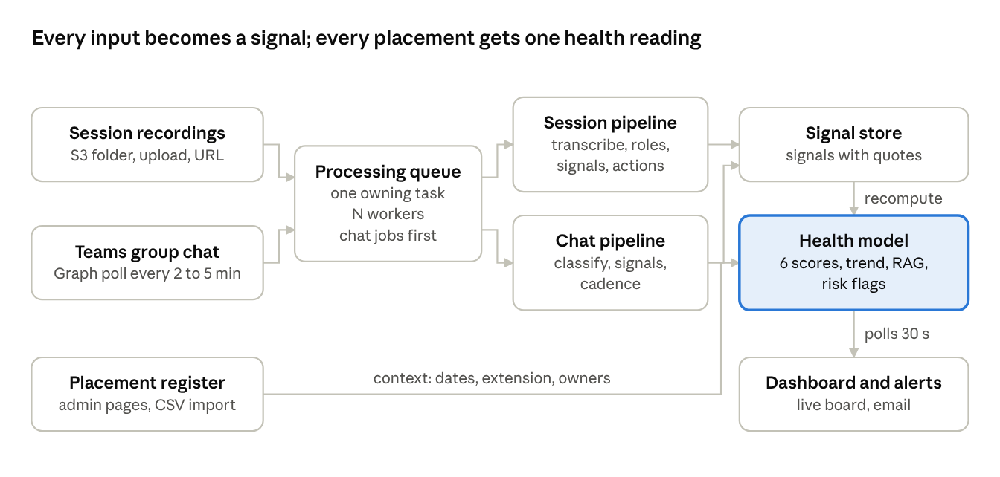
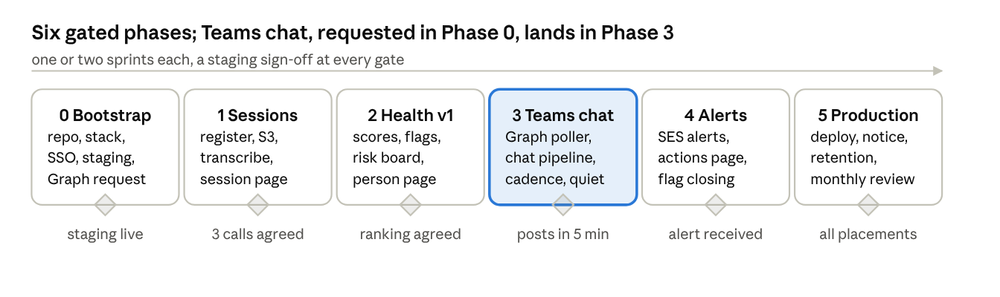

# PMO Intelligence — Project Starter

Oct 6, 2026 · @Kumar Verma

> This is the product requirements source of truth. It is a complete conversion of the kickoff document, keeping its wording. Decisions taken later are recorded in `docs/planning/CURRENT-SPRINT.md` (Decisions Log) and the sprint handovers. Open questions are tracked in `docs/planning/BACKLOG.md`.

---

## Purpose

PMO Intelligence gives the PMO a live health reading for every consultant on a client project, so a placement at risk is seen weeks before the client acts on it. Consultants are contractors: a client that is unhappy with delivery, fit or communication can end the engagement with little notice, and today the warning signs sit scattered across recorded PMO calls and Teams group chat where nobody can read everything.

The tool does for PMO sessions what Interview Intelligence does for interviews: it ingests the recordings and the chat, extracts structured intelligence with an LLM, and turns it into a per-consultant health score, a trend and a list of risk flags with the evidence behind each one. The PMO team, the tech leads and the placement specialists then act on the flags; the tool never decides anything about a consultant on its own.

Two questions it must answer at any moment:

1. Which consultants are at risk right now, and why? A ranked board of every active placement with a health score, trend arrow and open risk flags.
2. What is going on with this consultant? One page per consultant: the timeline of sessions and chat signals, the health history, the issues raised and the actions agreed, with links back to the recording and the message.

---

## Scope of version 1

Version 1 monitors active placements from two inputs, recorded PMO sessions and Teams group conversations, and shows health on a live dashboard with alerts. It is a separate product in its own repository; it shares the Interview Intelligence stack and patterns but no code at runtime and no database.

### In scope

- A register of consultants, clients, projects and placements (start date, expected end, extension status, client manager, our tech lead and placement specialist).
- Ingestion of recorded PMO sessions (onboarding help, technical help, check-in calls) with transcription and speaker roles.
- Ingestion of the Teams group conversations where the consultant posts updates and the PMO SMEs, PMO manager, tech lead and placement specialists post context.
- Per-session and per-message intelligence extraction: summary, issues, blockers, sentiment, relationship signals, actions, risk indicators, each with a quoted piece of evidence.
- A health model per placement: six dimensions scored 1 to 10, an overall score, a trend, a RAG risk level and open risk flags.
- A live dashboard: the risk board, the consultant page, the session page, the open-actions list.
- Alerts to the PMO when a placement turns amber or red, when a flag opens, or when a consultant has gone quiet.
- Role-based access, an audit log of who viewed whom, and a retention policy.

### Out of scope for version 1

- Any automated decision or message to the client or the consultant.
- Reading the client's own Teams or email; only our own group conversations and our own recorded calls.
- Video analysis (facial expression, camera-off detection); audio and text only.
- Timesheets, invoicing, utilisation or bench management.
- Predictions beyond the trend; a forecast model can come once there are enough closed placements to learn from.
- Interview data; the consultant's interview record stays in Interview Intelligence and can be linked later by name or email.

---

## Users and roles

Five roles read the tool; none of them is the consultant, and the client never sees it. Access follows the people already in the Teams groups.

| Role | What they do today | What they see in the tool |
|------|--------------------|---------------------------|
| PMO manager | Owns project health across every placement; escalates to the client or replaces a consultant | Everything: the risk board for every placement, every consultant page, alerts, the audit log, user and access admin |
| PMO SME | Runs the technical and onboarding help sessions | Consultants they support: session pages, open technical blockers, actions assigned to them |
| Tech lead | Reviews the consultant's technical delivery, posts context in the group | Consultants on their projects: health, technical dimension detail, open actions |
| Placement specialist (PS) | Placed the consultant; owns the client relationship and extensions | Consultants they placed: health, relationship and contract flags, extension status, alerts |
| Admin | Operates the tool | Ingestion sources, Teams connection status, processing queue, users and roles |

Two principles carry over from Interview Intelligence and should be built in from the first sprint: the scope a user may read is checked on the server for every route (a consultant page outside the user's scope answers 404, indistinguishable from a missing one), and every denial and every read of a consultant page is logged. The second matters more here than in Interview Intelligence, because the data is about identifiable people under contract.

---

## Inputs

Three inputs feed the model. The first two are the evidence; the third tells the tool who the evidence is about.

| Input | What it is | How it arrives | Volume to plan for |
|-------|-----------|----------------|--------------------|
| Recorded PMO sessions | Onboarding help, technical help and check-in calls between a consultant and the PMO; one consultant per call, sometimes an SME or tech lead too | Version 1: a recordings folder (S3, as the interview recordings arrive today) or a manual upload or URL. Later: Teams meeting recordings and transcripts through Microsoft Graph | Open question: how many calls a week, how long |
| Teams group conversations | One group per consultant (or per project) where the consultant posts updates and the PMO SMEs, PMO manager, tech lead and placement specialists post context | Microsoft Graph: new messages pulled on a schedule or pushed by change notifications; every message, reply and reaction, with author and time | Open question: how many groups, roughly how many messages a day |
| Placement register | Consultant, client, project, start date, expected end, extension status, client manager, our tech lead, PS, SME | Entered on an admin page, or imported once from the spreadsheet the PS team keeps today | Tens to low hundreds of active placements |

What each input contributes:

- A session gives depth: what the consultant is struggling with, how they talk about the team and the manager, what was promised and by whom. It is the richest signal and the slowest to arrive.
- The group chat gives frequency: a daily or weekly update, a stakeholder's note that the client asked for a change, a missed stand-up, silence. It is where "live" comes from, because sessions may be weeks apart.
- The register gives context the LLM cannot infer: how far into the contract the consultant is, whether an extension is due, who to alert.

Every stored session and message keeps its source reference (recording key, Teams message id, author, timestamp), so every flag on the dashboard links back to the words that raised it.

---

## The project health model

Health is a score per placement on six dimensions, each 1 to 10, combined into an overall score, a trend and a RAG level, and always shown with the evidence that produced it. The LLM never emits the score directly: it extracts signals with quotes, and a deterministic function turns signals into scores, so the same evidence always gives the same number and a reviewer can see why.

| Dimension | What it measures | Typical evidence |
|-----------|------------------|------------------|
| Delivery | Is the consultant delivering what the client expects, on time | Missed deadlines, rework, "the client asked again", praise for a shipped piece |
| Technical | Can they do the technical work of the role | Repeated help requests on the same topic, blockers that outlast a session, tech lead's assessment |
| Relationship | Chemistry with the team, the manager and superiors | How they describe the manager, conflict, exclusion from meetings, a stakeholder noting friction |
| Engagement | Morale, confidence, intent to stay | Tone across sessions, talk of leaving, stress, enthusiasm |
| Onboarding | Access, environment, process and people set up in the first weeks | Open access requests, no laptop, no buddy; weighted heavily in the first 30 days, then fades |
| Communication | Are they visible: updates posted, questions asked, stand-ups attended | Update cadence in the group, days since last post, unanswered stakeholder questions |

### Scoring rules

- Each extracted signal carries a dimension, a polarity (positive, negative, neutral), a severity 1 to 3, a confidence 0 to 1, a quote and a source. A session yields many signals; a message yields zero or a few.
- A dimension score is a time-decayed weighted average of its signals, with a half-life of about 14 days, so an old blocker fades and a fresh one bites. The decay constant is configuration, not code.
- The overall score is the weighted mean of the six dimensions. Weights are configuration; a starting point is Delivery 30 %, Relationship 25 %, Technical 15 %, Engagement 15 %, Communication 10 %, Onboarding 5 % (rising to 25 % in the first 30 days).
- The trend is the change in overall score over the last 14 days: up, flat or down.
- Risk level: green 7 to 10, amber 5 to 6.9, red below 5. Any open critical flag forces at least amber.

### Early-warning triggers

Early-warning triggers (each opens a risk flag with its evidence; the thresholds are configuration):

| Trigger | Condition | Severity |
|---------|-----------|----------|
| Gone quiet | No post from the consultant in the group for 5 working days | Medium |
| Client dissatisfaction | A stakeholder or the consultant reports the client manager is unhappy, escalated, or asked for a change of consultant | Critical |
| Repeated blocker | The same technical blocker appears in two sessions or persists more than 10 days | High |
| Downward trend | Overall score falls 1.5 points or more over 14 days | High |
| Relationship strain | A negative relationship signal with severity 3, or two with severity 2 in 14 days | High |
| Contract horizon | Expected end within 30 days and extension not confirmed | High |
| Intent to leave | The consultant mentions leaving, another offer, or not wanting to continue | Critical |
| Missed commitment | An action the consultant owned passes its due date without an update | Medium |

A flag stays open until a PMO user closes it with a note, so the risk board shows what is being handled and what is not. Closing a flag does not change the score; only new evidence does.

---

## Intelligence extraction

Two pipelines, one per input, both producing the same signal records so the health model has a single source. Both are LangGraph graphs of structured-output nodes with gpt-5.4-mini, as the interview pipeline is, with every node non-fatal and every call timed, costed and given a timeout.

### Session pipeline

Session pipeline (one run per recording, after transcription with speaker diarization):

1. Attribute roles: map diarized speakers to consultant, PMO SME, tech lead, other. Reuse the meeting role-attribution node from Interview Intelligence's meeting module.
2. Classify the session: onboarding, technical help, check-in, escalation, other, plus the project phase the consultant is in.
3. Summarise: a factual summary, in the reader's words, of what was discussed.
4. Extract issues and blockers: each with topic, who raised it, whether it is new or repeated, and status at the end of the call.
5. Extract relationship and engagement signals: how the consultant describes the team, the manager and superiors; morale; confidence; intent to stay. Each signal quotes the words.
6. Extract client signals: anything said about what the client expects, has praised or has complained about.
7. Extract actions: owner, description, due text, and whether it closes an earlier action.
8. Emit signals: every item above becomes a signal row with dimension, polarity, severity, confidence, quote and timestamp in the recording.

### Chat pipeline

Chat pipeline (one run per new message or per batch of messages in a thread; cheap, frequent):

1. Classify the message: consultant update, question, stakeholder context, praise, concern, escalation, administrative, noise. Noise (greetings, reactions, "thanks") stops here with no further call.
2. Extract signals from the rest, with the thread's recent messages as context so a reply is read against what it answers.
3. Track cadence without the LLM: last post by the consultant, posts per week, questions to the consultant left unanswered.

### Health recompute

Health recompute: after any pipeline run, the placement's six scores, overall, trend, RAG and triggers are recomputed from its signals and the register, and a snapshot is stored, so the dashboard reads a row rather than recomputing on every page load.

Two things the interview pipeline taught that apply here unchanged: ask the model for evidence quotes and reject a signal whose quote is not in the transcript, and keep every prompt's enumerations (dimensions, polarities, classes) in one code constant that the docs cite.

---

## Architecture and stack

Same stack as Interview Intelligence, a new repository, and three new pieces: a Microsoft Graph connector for Teams, the signal store with the health model, and a dashboard built around people rather than recordings. Keeping the stack identical means the team's rules, CI, Docker images, Terraform modules and the hard-won operational fixes carry over on day one.

*PMO Intelligence architecture · 3 inputs, 1 queue, 2 pipelines, 1 health model — "Every input becomes a signal; every placement gets one health reading".*

Diagram content in text form:

- **Session recordings** (S3 folder, upload, URL) and **Teams group chat** (Graph poll every 2 to 5 min) → **Processing queue** (one owning task, N workers, chat jobs first)
- Processing queue → **Session pipeline** (transcribe, roles, signals, actions) and **Chat pipeline** (classify, signals, cadence)
- Both pipelines → **Signal store** (signals with quotes) → recompute → **Health model** (6 scores, trend, RAG, risk flags)
- **Placement register** (admin pages, CSV import) → Health model (context: dates, extension, owners)
- Health model → polls 30 s → **Dashboard and alerts** (live board, email)

Recordings and chat both pass through the one processing queue into their pipelines; everything they extract lands in the signal store, the health model recomputes the placement after every job and reads the register for context, and the dashboard and alerts read the latest snapshot.

| Layer | Choice | Reuse or new |
|-------|--------|--------------|
| Backend | FastAPI, Python 3.12, SQLAlchemy 2.0 async, Alembic, Pydantic | Reuse the layering (routes → services → repositories → models) and the repo skeleton |
| Database | PostgreSQL 16 + pgvector | Reuse; embeddings let a reviewer search "who else had this blocker" |
| Transcription | AssemblyAI with speaker diarization; Teams' own transcript when a recording comes through Graph | Reuse the shared AssemblyAI client |
| LLM | Azure OpenAI gpt-5.4-mini through the LLM factory, LangGraph graphs, structured output | Reuse the factory, the cost tracker, the timeout setting, the non-fatal node pattern |
| Processing | One process-wide priority queue with N workers, a Postgres advisory lock so one task owns processing during a deploy, startup sweeps, a per-job session | Reuse as is; it cost three hotfixes to get right |
| Teams connector | Microsoft Graph: channel or chat messages, later meeting recordings and transcripts; app registration with application permissions | New (see the Teams section) |
| Signals and health | signals, health_snapshots, risk_flags, actions tables; a pure scoring module with the weights and thresholds in configuration | New |
| Alerts | Amazon SES email now; a Teams message to a PMO channel once the connector can write | Reuse the SES sender from the daily report |
| Frontend | Next.js 16 App Router, TypeScript strict, shadcn/ui, SWR, TanStack Table, Recharts, dark mode | Reuse the component library, the auth client, the admin page patterns |
| Auth | Microsoft Entra ID SSO only, roles on the user row, bootstrap admin list from configuration | Reuse; replace the UK/US entitlement with role plus consultant scope |
| Infra | AWS eu-west-2: ECS Fargate, RDS, S3, ALB, Secrets Manager, CloudWatch, Terraform; GitHub Actions CI with unit, integration (testcontainers) and Playwright | Reuse the modules; a separate RDS database on the existing instance to start, its own bucket, its own ALB rules or hostname |

What is deliberately not shared: no shared database, no shared service code at runtime, no monorepo. Copy the files that are worth copying into the new repo (the processing queue, the ownership lock, the LLM factory, the entitlement helper shape, the test conftests) and let them diverge. A shared library would couple two release trains for code that changes a few times a year.

---

## Data model draft

The placement is the unit of health; the consultant, the client and the project are its context. Every table carries id, created_at and updated_at as in Interview Intelligence.

| Table | Key fields | Notes |
|-------|-----------|-------|
| consultants | full_name, email, entra_oid (nullable), phone, skills, status (bench / placed / left) | One row per person; entra_oid links the Teams author to the consultant |
| clients | name, normalized_name, industry | Dedup on normalized_name, as companies does |
| projects | client_id, name, client_manager_name, tech_lead_user_id, start_date | One client can run several projects |
| placements | consultant_id, project_id, start_date, expected_end_date, extension_status (not_due / due / requested / confirmed / declined), rate_band, ps_user_id, sme_user_id, status (active / ended / terminated), ended_reason | The unit everything else hangs off; ended_reason is what a forecast model would later learn from |
| teams_groups | placement_id (nullable), project_id (nullable), graph_team_id, graph_channel_id or graph_chat_id, kind (channel / group_chat), is_active, last_synced_at, delta_token | One Teams conversation watched for one placement or project |
| sessions | placement_id, kind (onboarding / technical / check_in / escalation / other), held_at, duration_seconds, source (s3 / upload / url / graph), recording_key, graph_meeting_id, status (uploaded → transcribing → transcribed → analyzing → completed / failed), error_message | One recorded PMO call |
| session_transcripts | session_id (unique), full_text, utterances (JSONB), speaker_roles (JSONB), summary, session_class | Diarized transcript and the roles the LLM attributed |
| messages | teams_group_id, graph_message_id (unique with group), author_entra_oid, author_role (consultant / pmo_manager / sme / tech_lead / ps / other), posted_at, body_text, reply_to_message_id, message_class, is_noise | The raw chat, kept so a flag can quote it; message_class from the chat pipeline |
| signals | placement_id, source_kind (session / message), source_id, dimension, polarity, severity (1–3), confidence (0–1), quote, note, occurred_at, embedding (1536D) | The one table the health model reads; indexed on (placement_id, occurred_at) |
| issues | placement_id, topic, first_seen_at, last_seen_at, occurrence_count, status (open / resolved), resolved_at | A blocker followed across sessions; the repeated-blocker trigger reads it |
| actions | placement_id, source_kind, source_id, owner_role, owner_user_id (nullable), description, due_text, due_date (nullable), status (open / done / overdue), closed_at | What was agreed on a call or in the group |
| health_snapshots | placement_id, computed_at, delivery, technical, relationship, engagement, onboarding, communication, overall, trend, risk_level, signal_count, weights_version | One row per recompute; the dashboard reads the latest, the chart reads the history |
| risk_flags | placement_id, trigger (the enumerated triggers), severity, opened_at, evidence_signal_ids, closed_at, closed_by_user_id, closing_note | Open until a person closes it |
| users | email, full_name, entra_oid, role (pmo_manager / sme / tech_lead / ps / admin), is_active | Role is the entitlement; a user's scope is derived from the placements naming them |
| processing_jobs, processing_costs, refresh_tokens | as in Interview Intelligence | Costs keyed by session_id or message_id, nullable, so chat runs are costed too |
| access_log | user_id, placement_id, route, at | Who looked at whom; required by the privacy section |

Two decisions worth making before the first migration: whether a Teams group maps to a placement or to a project (a project group with two consultants needs the author's identity to attribute a message), and whether the register is owned here or imported from the PS team's system of record.

---

## Microsoft Teams integration

The Teams connector is the one part of this project with an external dependency that can take weeks rather than days: reading Teams messages as an unattended application needs permissions that Microsoft gates. Start the permission request in Sprint 0, before any code depends on it, and build the first sprints on recordings from a folder so nothing waits on it.

### Reading the group conversations

Reading the group conversations. Three routes, in order of preference; confirm the current Graph rules in the planning research, because they change:

| Route | How it works | Permission | Catch |
|-------|--------------|------------|-------|
| Resource-specific consent (RSC) | A small Teams app is installed into each group; the app may then read that team's channel messages or that chat's messages without tenant-wide consent | ChannelMessage.Read.Group or ChatMessage.Read.Chat, granted per team or chat at install | An admin must allow RSC in the tenant; the app has to be installed in every watched group, which is also a clean way to show the group it is being read |
| Application permissions | One app registration reads every team's messages | ChannelMessage.Read.All, Chat.Read.All (application) | These are Microsoft "protected APIs": an approval form, a justification and a wait; broader than the PMO needs |
| Delegated permissions with a service account | A PMO service user signs in once; the tool keeps its refresh token and reads what that user can see | ChannelMessage.Read.All, Chat.Read (delegated) | Breaks whenever the account's password, MFA or token lifetime changes; the Interview Intelligence SSO-secret lockout is the warning |

Whether the groups are team channels or group chats decides which endpoints and permissions apply, so that is the first fact to establish.

### Keeping it current

Keeping it current. Poll each watched group every 2 to 5 minutes with the delta endpoint (channels) or a last-modified filter (chats), storing the token or watermark on the teams_groups row; one short request per group per poll, and a group that has not changed costs almost nothing. Change notifications (webhooks) can replace polling later, but their subscriptions for chat messages expire within the hour and need a public endpoint and a renewal loop, so they are an optimisation, not the first build.

### Reading the sessions

Reading the sessions. Version 1 takes recordings from an S3 folder, an upload or a URL, as Interview Intelligence does, with AssemblyAI for the transcript. Once the calls are Teams meetings recorded in Teams, Graph can hand over the recording and Teams' own transcript (OnlineMeetingRecording.Read.All, OnlineMeetingTranscript.Read.All, application permissions plus an application access policy assigned to the organisers), which removes the transcription cost. Meeting Intelligence's Phase 1b work (Teams and SharePoint links need Files.Read.All and admin consent) is the same portal exercise.

### Writing to Teams

Writing to Teams (alerts into a PMO channel) is a later phase and needs its own permission; email through SES covers alerts until then.

### Risks

Risks to carry on the plan: protected-API approval lead time; a tenant admin's consent for each permission; Graph throttling on the first full history pull (page slowly, keep the watermark, resume); messages edited or deleted after ingestion (store lastModified, re-read on delta, honour deletion); and the two tenants, if any PMO group lives in a partner tenant, because the allowlist work in Interview Intelligence showed those need separate consent.

---

## Live monitoring and alerts

"Live" means a placement's health reflects every message within minutes and every session within the hour, the risk board refreshes itself, and a change that matters reaches a person without them opening the tool.

### How health stays current

- The Teams poller writes new messages and enqueues a chat-pipeline job per thread; the recordings scanner (or an upload) enqueues a session job. Both go through the one processing queue, chat jobs at a higher priority than session jobs because they are small and many.
- Every completed job triggers a health recompute for its placement and stores a health_snapshot.
- A scheduler recomputes every active placement once a day regardless, so time-based triggers (gone quiet, contract horizon, overdue action) fire even when nothing new arrives, and the decay of old signals is reflected.
- The dashboard reads the latest snapshot per placement and polls every 30 seconds while open; a page for one consultant polls every 10 seconds while a job for that placement is running, as the interview page does.

### Pages

| Page | Shows |
|------|-------|
| Risk board (home) | Every active placement as a row: consultant, client and project, weeks in, overall score with a colour, trend arrow, open flags, days since last post, next action due. Sorted red first, then by trend. Filters by PS, tech lead, client, risk level |
| Consultant page | Header with the six dimension scores and the overall; the health chart over the placement's life with session markers; open flags with their evidence; the timeline of sessions and notable messages; open issues; actions; the register fields |
| Session page | Summary, speaker-attributed transcript, the signals it produced with quotes, the actions agreed, the cost |
| Actions | Every open action across placements, by owner and due date |
| Admin | Placement register, watched Teams groups and their sync status, recordings source, processing queue, users and roles |

### Alerts

Alerts go by email through SES, later as a message in a PMO Teams channel:

- Immediately: a placement turns red, or a critical flag opens (client dissatisfaction, intent to leave). To the PMO manager, the PS and the tech lead on that placement.
- Daily at a configured hour: a digest per PMO manager of every amber and red placement, flags opened and closed, and consultants gone quiet. Same shape as the Interview Intelligence daily report.
- Weekly: a portfolio summary with the health distribution, movers up and down, and the sessions and messages processed.

An alert carries the evidence quote and a link to the consultant page, never the score alone. Alert rules and recipients are configuration, with a per-placement override so a PS can watch one consultant closely.

---

## Privacy, consent and access control

This tool profiles identifiable people under contract from their recorded conversations, which puts it under UK GDPR as monitoring of workers, so the controls below are part of version 1, not a later hardening sprint. None of them slows the build; most are the same patterns Interview Intelligence already runs.

- **Tell the consultants.** A short written notice at placement start: PMO calls are recorded and analysed, the project group is read, what is extracted, who sees it, how long it is kept, and whom to ask. Teams already shows a recording banner; the notice covers the analysis. Legal basis and the notice wording are for HR or counsel to confirm, not for the engineering plan to decide.
- **A person decides, the tool informs.** No score or flag triggers any action on a consultant automatically; every flag is closed by a named user with a note. Say so in the notice.
- **Minimise.** Store the signals and quotes the model needs; do not run sentiment on every message of every stakeholder. Noise is dropped before the LLM. Nothing from the client's side is ingested.
- **Scope reads on the server.** A user sees the placements that name them (PS, tech lead, SME) or everything (PMO manager, admin). The check is a FastAPI dependency on every by-id route, answering 404 outside scope, as in Interview Intelligence; a coverage test fails the build for any route without it.
- **Log every read.** The access_log row per consultant-page view, plus WARNING lines for every denial. The PMO manager can see who looked at whom.
- **Retain for a purpose, then delete.** Suggested starting point: raw recordings 90 days after the session, transcripts and messages for the placement plus 12 months, signals and snapshots for the placement plus 24 months, then deletion by a scheduled job. Confirm with HR; the numbers are configuration.
- **Handle a request.** A consultant can ask what is held about them; the consultant page plus the signals export answers it, so build the export early.
- **Secrets and keys.** Graph client secrets and certificates in Secrets Manager with the expiry date recorded and an alert before it, after the SSO secret lockout. Prefer a certificate credential for the Graph app.
- **Keep the model honest.** Reject a signal whose quote does not appear in the source, show the confidence, and review a sample of flags each month against what actually happened to the placement, so the weights are tuned on outcomes rather than opinion.

---

## Phased delivery plan

Six phases, each one or two sprints, each ending with a staging sign-off before the next starts, as the Interview Intelligence sprints run. The first health score is on screen after Phase 2; Teams chat, the source of "live", lands in Phase 3, with its permission request started in Phase 0 so it is ready by then.

*delivery roadmap · 6 phases, a gate under each — "Six gated phases; Teams chat, requested in Phase 0, lands in Phase 3" (one or two sprints each, a staging sign-off at every gate).*

Each diamond is a staging sign-off by the PMO manager before the next phase starts; Phase 3 is highlighted because its Teams permission is the one dependency outside the team's control.

Diagram content in text form: 0 Bootstrap (repo, stack, SSO, staging, Graph request → *staging live*) · 1 Sessions (register, S3, transcribe, session page → *3 calls agreed*) · 2 Health v1 (scores, flags, risk board, person page → *ranking agreed*) · **3 Teams chat** (Graph poller, chat pipeline, cadence, quiet → *posts in 5 min*) · 4 Alerts (SES alerts, actions page, flag closing → *alert received*) · 5 Production (deploy, notice, retention, monthly review → *all placements*).

| Phase | Delivers | Exit gate |
|-------|----------|-----------|
| 0 Bootstrap | New repo from the sprint-system blueprint; the stack copied from Interview Intelligence (queue, ownership lock, LLM factory, auth, CI, Docker, Terraform); SSO sign-in with roles; empty dashboard deployed to staging. Graph app registration created and the Teams permission request submitted | Staging URL signs in; CI green; the permission request has a ticket number |
| 1 Register and sessions | Placement register (admin pages, CSV import); session upload, URL and S3 folder ingestion; transcription; the session pipeline; session page | Three real recorded PMO calls processed end to end; the PMO manager agrees the signals and summary are right |
| 2 Health v1 | The signal store, scoring module, snapshots, triggers, flags; the risk board and the consultant page; daily recompute | Ten placements scored from their sessions; the PMO manager agrees with the ranking, or the weights are tuned until they do |
| 3 Teams chat | Graph connector (RSC or application permission), poller, message store, chat pipeline, cadence tracking; messages on the timeline; the gone-quiet and missed-commitment triggers | One real group watched for a week; new posts appear within 5 minutes; no message read outside the watched groups |
| 4 Alerts and actions | SES alerts (immediate, daily digest, weekly summary); the actions page; flag closing with notes; the access log view | Alerts received for a staged red placement; a PS closes a flag and it shows on the board |
| 5 Production and tuning | Production deploy; the consultant notice issued; retention job; a monthly review of flags against outcomes; Teams meeting recordings and transcripts through Graph if the calls are held in Teams | Live for every active placement; first monthly review done |

A later phase, once there are closed placements with recorded outcomes, can add a forecast (probability of early termination) learned from the signal history. It is deliberately not in version 1: with no outcomes to learn from, a forecast would be a guess dressed as a number.

---

## Decisions needed before Sprint 1

These are the questions the first planning session will ask; answering them here saves that session a round of questions. Each one changes the data model, the Teams work or the health model.

| # | Question | Why it matters | Suggested answer |
|---|----------|----------------|------------------|
| 1 | Are the Teams groups team channels or group chats, one per consultant or one per project? | Decides the Graph endpoints, the permission route and whether teams_groups hangs off a placement or a project | One group chat per placement, if that is how they exist today |
| 2 | Where do PMO call recordings live today: a Nextcloud or S3 folder like the interviews, Teams meeting recordings, or nowhere yet? | Decides whether Phase 1 reuses the S3 scanner or starts with upload only, and whether Graph recording access is needed | Reuse the S3 scanner if a folder exists; otherwise upload and URL first |
| 3 | Who is the system of record for placements: this tool, or the PS team's spreadsheet or CRM? | Owning it here means admin pages; importing means a sync and a source of truth elsewhere | Own it here, seed it once from the spreadsheet |
| 4 | Which route for Teams permissions: RSC per group, application permissions through Microsoft's approval, or a service account? | Lead time and tenant-admin involvement | RSC, with application permissions requested in parallel as the fallback |
| 5 | Who may see what: is a PS limited to their own placements, and may an SME see health scores or only their technical sessions? | The role model and the scope check | PS and tech lead scoped to their placements; SME sees sessions and the technical dimension only; PMO manager sees all |
| 6 | Do consultants know their calls and group are analysed, and who issues the notice? | Lawful basis under UK GDPR; the wording is HR's | HR issues a notice at placement start; the tool's first production deploy waits for it |
| 7 | Starting weights and thresholds for the six dimensions and the triggers | They are configuration, but the first values shape whether the PMO trusts the board | The values in the health section, tuned at the Phase 2 gate |
| 8 | One environment or two (staging and production), and does it share the RDS instance with Interview Intelligence? | Cost and blast radius; the shared db.t4g.small is already at two databases | Two environments; a separate database on the existing instance to start, its own instance once production load is known |
| 9 | UK only, or UK and US from the start? | The branch dimension cost Interview Intelligence two sprints to retrofit | Model branch on placements from day one even if only UK is populated |
| 10 | Name and hostname | Repo, Entra app registration, Route 53 record, ECR repositories | pmo-intelligence, pmo.itcapp.ai and pmo-staging.itcapp.ai |

---

## Repo bootstrap checklist

The order for the first day in the new repository. Everything below is Phase 0; nothing product-specific is written until the first sprint is planned from this document.

- [ ] Create the private GitHub repository pmo-intelligence with main and develop; branch protection on both; the CI checkout token recorded with its expiry date
- [ ] Apply the sprint-system blueprint: the project instructions file, the local rules and skills, the git hooks, the ignore files, and the docs/ tree (planning, tracking, handover, the audit template). Keep the local-only files out of git from the first commit
- [ ] Write docs/PRD.md from this document: purpose, scope, users, inputs, the health model, privacy; and docs/ARCHITECTURE.md with the stack table and the diagram above. Put this document's decisions table into docs/planning/BACKLOG.md as open questions
- [ ] Copy the backend skeleton from Interview Intelligence: pyproject.toml and lockfile, app/main.py lifespan, app/config.py, app/db/, the processing queue, ownership lock and reconcile sweeps, the LLM factory with its timeout, the cost tracker, the entitlement helper shape, the exceptions module, the security and body-size middleware, both test conftests. Delete the interview, company, ingestion and meeting modules; keep the auth module
- [ ] Copy the frontend skeleton: Next.js app with the auth client and provider, the layout, sidebar, theme, error boundaries, the ui/ components, the SWR hooks pattern, the test setup. Delete the interview, company, technology and meeting pages
- [ ] Copy .github/workflows/ (CI with unit, integration and Playwright; build-and-push with path filters), both Dockerfiles, docker-compose.yml, Makefile, .env.example
- [ ] Copy infra/ and rename every resource; new ECR repositories, a new secret, a new log group, new ALB rules or a new hostname, a new database on the shared RDS instance; terraform plan only, until the state is clean from the start
- [ ] Entra: one app registration for SSO (the same multi-tenant and allowlist settings), a second for Graph with a certificate credential; record both expiry dates; submit the Teams permission request (decision 4)
- [ ] Migration 001: users, refresh_tokens, consultants, clients, projects, placements, processing_jobs, processing_costs, access_log; BOOTSTRAP_ADMIN_EMAILS for the first PMO manager
- [ ] Deploy the empty app to staging; sign in with SSO; CI green on develop; write the Sprint 0 handover
- [ ] Run the first sprint planning from this document: read the decisions table, confirm answers, plan Phase 1
